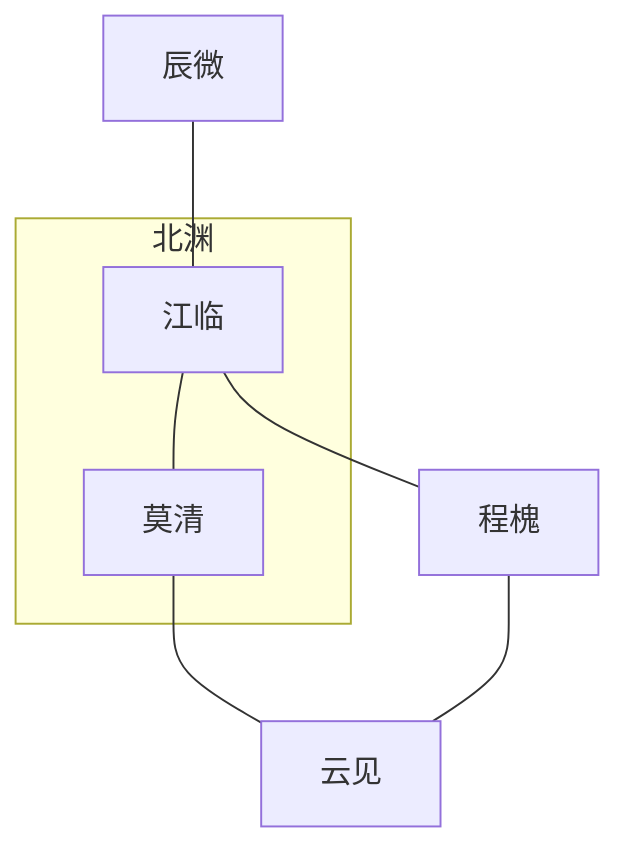

# Canon Bible｜角色卡 + 阵营关系（v3）
> 模板示例，请按项目替换与扩充。

## 1. 主配角卡
| id | 姓名 | 绰号 | MBTI | 年龄 | 阵营 | 目标 | 缺陷 | 背景 | 成长弧线 |
|---|---|---|---|---|---|---|---|---|---|
| c01 | 江临 | 霄影 | INTJ | 23 | 北渊调查组 | 找到旧案真相 | 冷感疏离 | 北渊旧案遗孤 | 复仇→承担 |
| c02 | 莫清 |  | ENFJ | 26 | 城防司 | 维护秩序 | 过度共情 | 北渊城青年指挥 | 理想→现实平衡 |
| c03 | 程槐 | 鹤客 | ISTP | 28 | 情报司 | 追索身世 | 冲动独行 | 深潜外勤 | 孤立→协作 |
| c04 | 辰微 |  | INFP | 22 | 学院派 | 术法民用 | 逃避冲突 | 新科毕业 | 退缩→直面 |
| c05 | 云见 |  | ENTJ | 31 | 商会 | 扩张与稳定 | 控制欲强 | 家族继承者 | 强硬→合作 |

## 2. 阵营要点
- 北渊调查组：资源有限，掌握旧案线索。
- 城防司：秩序导向，与商会存在灰度合作。
- 情报司：情报优势强，内部派系复杂。
- 商会：资本与民生议题交织。

## 3. 关系网络（Mermaid）

